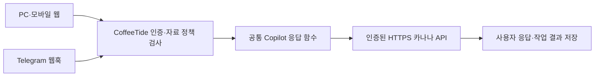

# CoffeeTide 카나나 서버 연결

- 작성일·기준일: 2026-10-26
- 환경: CoffeeTide Next.js / Vercel, 별도 Oracle 모델 서버
- 목적: Oracle 구축 담당자와 CoffeeTide 배포 담당자가 같은 API 계약으로 연결한다.
- 상태: 호출 로직 구현. 2026-11-03 사용자 보고에 따르면 서버 성능 제약과 느린 실사용 응답이 있어 추가 측정 전 시험용으로 유지한다. 이 작업에서는 실서버에 접속하지 않았다.

| 참고 | 위치 |
|---|---|
| 제공자 선택 | `src/lib/ai/copilotService.ts` |
| 카나나 호출·프롬프트·오류 처리 | `src/lib/ai/kanana.ts` |
| 환경변수 이름 | `.env.example` |
| 공식 모델 | https://huggingface.co/kakaocorp/kanana-2-1.3b-instruct |

| PART | 내용 |
|---|---|
| 1 | 적용 범위 |
| 2 | 서버 API 계약 |
| 3 | 연결·복구 절차 |
| 4 | 검증 및 한계 |

---
---
# PART 1 — 적용 범위

## 1-1 호출 구조



| 조건 | 동작 |
|---|---|
| `COPILOT_AI_PROVIDER` 미설정 또는 `gemini` | 기존 Gemini 호출 및 기존 대체 응답 유지 |
| `COPILOT_AI_PROVIDER=kanana` | 웹 Copilot·바리스타 채팅과 Telegram 공통 대화 경로에서 카나나 사용 |
| 주소·인증값 누락, 잘못된 제공자 이름 | 외부 호출 없이 대체 응답 및 `invalid_config` 기록 |
| 카나나 오류 | 로컬 규칙 대체 응답. Gemini로 자동 재전송하지 않음 |
| 대화 전용 모드 | 업무 자료 제외 |
| 업무 모드 | 호출부의 사용자별 권한 검사 후 `cloud_allowed` 자료만 전송 |
| 자동 도구 실행 | 카나나 경로에서는 제공하지 않음 |

일정 등록 전용 추출, 캔버스, 영상 분석, 음성, 자동 잡담 및 기타 Gemini 기능은 이번 선택 설정의 적용 범위에 포함하지 않는다. 웹의 기존 명시적 명령 처리 경로는 유지한다. Telegram 연결·DB·웹훅 배포는 별도 작업이다.

---
---
# PART 2 — 서버 API 계약

## 2-1 환경변수

모두 CoffeeTide 서버 전용이다. `NEXT_PUBLIC_` 접두사를 붙이지 않는다. 주소와 인증값을 Git 파일이나 대화에 붙여 넣지 말고 배포 환경의 설정으로 관리한다.

| 이름 | 설정 |
|---|---|
| `COPILOT_AI_PROVIDER` | 구축·검증 전 `gemini`, 연결 시 `kanana` |
| `KANANA_API_URL` | `/v1/chat/completions`까지 포함한 전체 HTTPS 주소. 경로 자동 추가 없음 |
| `KANANA_API_KEY` | Oracle에서 확인하는 Bearer 인증값. 필수 |
| `KANANA_MODEL` | 기본 `kakaocorp/kanana-2-1.3b-instruct`. 서버에서 제공하는 모델 이름과 일치 |
| `KANANA_TIMEOUT_MS` | 기본 120000. 허용 범위 1000~180000ms |
| `KANANA_MAX_OUTPUT_TOKENS` | 기본 256. 허용 범위 32~256 |
| `KANANA_MAX_INPUT_BYTES` | 기본 6000. 허용 범위 2048~16000 UTF-8 바이트 |

URL에 사용자명·비밀번호·쿼리·fragment는 허용하지 않는다. 개발 PC의 비운영 환경에서만 localhost HTTP를 허용하며 Vercel에서는 항상 HTTPS가 필요하다. 리디렉션을 따르지 않는다.

## 2-2 요청과 응답

- 방식: `POST`, `Content-Type: application/json`, `Authorization: Bearer <배포 환경에서 주입>`.
- 요청 필드: `model`, `messages`, `stream=false`, `max_tokens`, `temperature=0.2`.
- `messages`는 `system`과 `user` 두 메시지다. `user` 내용에는 질문·제한된 자료·최근 대화가 JSON 문자열로 들어간다.
- 서버는 `choices[0].message.role="assistant"`, `choices[0].message.content`에 최종 답변 문자열을 반환한다.
- 내부 추론은 별도 내부 필드에만 두고 최종 `content`에는 넣지 않는다.
- 도구 호출 응답, 빈 응답, 잘못된 JSON, 64KiB를 넘는 응답은 실패 처리한다.
- 요청은 자동 재시도하지 않는다. 처리 중에는 서버가 429 또는 503을 반환할 수 있다.

성공 응답 예시이며 실제 모델 검증 결과는 아니다.

```json
{
  "choices": [{
    "message": { "role": "assistant", "content": "제공된 자료에 따르면 회의는 오후 3시입니다." },
    "finish_reason": "stop"
  }]
}
```

## 2-3 Oracle 담당자 확인 항목

| 항목 | 요구 조건 |
|---|---|
| 접근 주소 | Vercel에서 접근 가능한 신뢰할 수 있는 인증서의 HTTPS 주소 |
| 모델 프로세스 | 한 번만 적재하고 요청 생성은 한 번에 1건 |
| 대기 제한 | 대기열·대기 시간 제한, 초과 시 429 또는 503 |
| 인증 | 요청마다 Bearer 인증 확인, 인증 없는 공개 추론 금지 |
| 입력 길이 | 실제 토크나이저로 시스템·대화 템플릿·출력을 포함한 한도 검사 |
| 시간 제한 | CoffeeTide 제한보다 짧은 생성·대기 제한, 가능한 경우 연결 종료 시 생성 취소 |
| 로그 | 질문·대화·자료 원문과 인증값 저장 금지 |

Vercel에서 Oracle의 `127.0.0.1`이나 사설 주소만으로는 접근할 수 없다. 외부 HTTPS 연결 또는 별도로 구성한 사설 연결이 필요하다.

---
---
# PART 3 — 연결·복구 절차

## 3-1 연결 순서

1. Oracle 담당자는 모델 이름, 전체 API 주소, 인증값을 전달하는 안전한 방법을 준비한다.
2. 개발·미리보기 환경에 서버 환경변수를 설정하고 이번 소스를 배포한다.
3. 실제 모델로 한국어 인사·업무 요약과 오류 응답을 확인한다.
4. 사용자 계정 두 개로 자료·대화 격리를 확인한다.
5. 사용자 운영 반영 절차에 따라 같은 설정과 소스를 반영한다.

## 3-2 복구

`COPILOT_AI_PROVIDER=gemini`로 변경하고 환경변수가 적용되도록 재배포하면 기존 경로로 돌아간다. `GEMINI_API_KEY`도 해당 환경에 있어야 Gemini가 실행된다. 카나나 실패 시 기본 정책은 로컬 대체 응답이며 자동으로 다른 외부 제공자를 호출하지 않는다.

---
---
# PART 4 — 검증 및 한계

## 4-1 응답 진단

| 필드 | 의미 |
|---|---|
| `providerUsed` | `kanana`, `gemini_cloud`, `local_rules` 중 실제 처리 경로 |
| `ai_fallback` | 생성 모델 응답을 사용할 수 없으면 true |
| `ai_error_code` | `invalid_config`, `input_too_long`, `timeout`, `busy`, `unavailable`, `invalid_response` |
| `context_limited` | 카나나 입력 크기를 맞추려고 보조 문맥을 줄였는지 표시 |

입력 제한은 모델 토큰 수가 아닌 UTF-8 바이트 기준이다. 시스템·질문을 먼저 보존하고, 질문 자체가 한도를 넘으면 보내지 않는다. 보조 문맥은 관계 맥락 최대 240자, 최근 대화 최대 4개 메시지, 업무 최대 8개 항목으로 제한하고 전체 바이트 한도 안에서 추가한다. 서버의 실제 토큰 제한을 대체하지 않는다.

웹 응답의 근거 목록도 카나나에 실제 전달한 항목으로 제한한다. 일부 자료만 전달되므로 전체 업무를 모두 검토한 것으로 해석하지 않는다. 브라우저의 기존 온디바이스 대체 경로가 작동하면 최종 화면 응답은 서버의 `providerUsed`와 다를 수 있다.

⚠️ Oracle 모델 응답 품질·속도, Vercel에서의 실제 연결, 실제 모바일·Telegram 수신은 서버 구축과 별도 배포 후 검증해야 한다.

로컬 검증 기록은 `workspace/2026-10/2026-10-26/kanana-client/README.md`에 남긴다. 시험용 HTTP 서버는 모델 생성·실제 Oracle 연동으로 보고하지 않는다.

## 4-2 성능 재검증 전 사용 기준 (2026-11-03)

기본 제공자는 Gemini로 유지한다. Kanana는 속도·품질 기준을 만족하는지 실제 서버에서 추가 측정한 뒤 전환 여부를 결정한다. Telegram 초기 연동도 Gemini 기본 경로를 사용한다.

측정 준비와 명령은 `workspace/2026-11/2026-11-03/integration-readiness/KANANA-TESTING.md`에 있다. 도구 `kanana-benchmark.mjs`는 기본 실행에서 외부 요청을 하지 않으며, 담당자가 `--run`을 지정할 때만 가상 질문을 순차 전송한다. 질문·답변 원문, 서버 주소와 인증값을 결과에 기록하지 않는다.

HTTP 헤더 응답 시간과 전체 응답 시간을 기록한다. 현재 API는 stream=false이므로 첫 토큰 지연은 측정하지 않는다. 동일 출력 제한에서 첫 요청·반복 요청을 비교하고, 별도로 서버 사양·추론 엔진·메모리·동시 요청·한국어 답변 품질을 확인한다. 소수 표본의 응답만으로 실사용 가능 판정을 내리지 않는다.

로컬의 기존 HTTP 계약 시험은 모델 속도 검증이 아니다. KANANA_TIMEOUT_MS는 대기 상한이며 이를 늘려도 서버의 생성 속도는 개선되지 않는다. `COPILOT_AI_PROVIDER=kanana`는 웹과 Telegram 공통 대화 경로에 함께 적용되므로, 추가 시험 중에는 기본값을 바꾸지 않는다.
